# Aelaro

### A ranked SEC filing changelog for public-market analysts

Aelaro scans the S&P 500 for exact-date 10-K and 10-Q filings, ranks the filings most likely to deserve analyst attention, compares the highest-ranked filings against their prior comparable filings, and generates source-backed disclosure changelogs.

**Live Website:** [aelaro.com](https://aelaro.com)

**Full Video Demo:** [Watch on YouTube](https://www.youtube.com/watch?v=vRz2e5La1vg)

[](https://www.youtube.com/watch?v=vRz2e5La1vg)

---

## The Problem

Market analysts cannot manually read every SEC filing.

During earnings season, hundreds of companies file long 10-Q and 10-K documents. Important changes involving financing, acquisitions, risk factors, liquidity, restructuring, legal matters, or company operations may be buried inside hundreds of pages of regulatory text.

Analysts often spend significant time finding what changed before they can begin analyzing why it matters.

Aelaro is designed to make that first stage faster.

---

## What Aelaro Does

A user selects a filing date and starts the workflow.

Aelaro then:

1. Loads the S&P 500 company universe.
2. Maps each company to its SEC Central Index Key, or CIK.
3. Searches SEC EDGAR for 10-K and 10-Q filings submitted on the selected date.
4. Builds a complete filing queue for that day.
5. Ranks the queue using deterministic disclosure signals.
6. Selects the three highest-signal filings.
7. Finds each company’s prior comparable filing.
8. Uses OpenAI to compare the current and prior filing text.
9. Returns a structured, source-backed changelog.

The final output shows analysts which filings may deserve review first, what changed, why the change may matter, and where the evidence can be verified.

---

## How the Workflow Functions

```mermaid
flowchart LR
    A[Select filing date] --> B[Load S&P 500 universe]
    B --> C[Map companies to SEC CIKs]
    C --> D[Scan SEC EDGAR in batches]
    D --> E[Build exact-date filing queue]
    E --> F[Rank filings before AI]
    F --> G[Select top three]
    G --> H[Find prior comparable filings]
    H --> I[Compare filing pairs with OpenAI]
    I --> J[Filter and structure results]
    J --> K[Display source-backed changelog]
```



### 1. Select a Filing Date

The user can choose the current day or a historical SEC filing date.

One click begins the complete scan, ranking, and comparison workflow.

### 2. Scan the S&P 500

Aelaro loads the S&P 500 issuer universe and maps each company to its SEC identifier.

It then checks SEC EDGAR for qualifying filings submitted on the selected date and collects matching:

- 10-Q quarterly reports
- 10-K annual reports

The result is a filing queue representing the qualifying S&P 500 filings found for that day.

### 3. Run the Scan in Browser-Controlled Batches

A full S&P 500 scan can be too large for one serverless request.

Instead, the browser acts as the workflow controller:

- Companies are divided into smaller batches.
- Multiple short requests are sent to the Vercel backend.
- Each request scans part of the S&P 500.
- The browser combines the returned results.
- Live progress is displayed throughout the run.

This architecture reduces the chance of a single long request reaching a serverless timeout.

### 4. Rank Filings Before Calling OpenAI

OpenAI does not analyze every filing.

Aelaro first uses deterministic code to score filing metadata and filing-preview text. Higher-value disclosure signals include subjects such as:

- Mergers and acquisitions
- Credit agreements
- Senior notes and financing
- Liquidity changes
- Going-concern language
- Material weaknesses
- Impairments
- Restructuring
- Investigations and settlements
- Customer or supplier concentration
- Share repurchases
- Joint ventures
- Hedging and interest-rate swaps
- Cybersecurity incidents
- Restatements

Routine or low-information language is deprioritized, including:

- Signature-only changes
- Generic filing mechanics
- Unchanged risk-factor language
- Statements that no legal proceedings exist
- Statements that no environmental matters exist
- Routine 10b5-1 disclosures
- Unchanged boilerplate

This produces a ranked filing queue before any AI comparison occurs.

### 5. Select the Highest-Signal Filings

By default, only the top three filings move to the AI comparison stage.

This keeps the workflow focused and reduces unnecessary API usage.

For example, a demonstrated May 7, 2026 run produced:

- **500 companies scanned**
- **48 qualifying filings found**
- **3 highest-ranked filings selected for analysis**

### 6. Find the Prior Comparable Filing

For each selected company, Aelaro searches the company’s SEC submission history for the best comparison document.

The preferred comparisons are:

- Current 10-Q versus prior 10-Q
- Current 10-K versus prior 10-K

For quarterly filings, the system can also locate the latest prior 10-K as secondary context when useful.

### 7. Compare Current and Prior Filings

Aelaro retrieves the current and prior SEC filing documents, extracts and cleans the text, and sends the relevant filing excerpts to OpenAI.

The model receives:

- Company and ticker information
- Filing dates and form types
- Current filing text
- Prior comparable filing text
- Ranking score and ranking reasons
- Direct SEC source URLs
- Optional prior annual-report context

The model is instructed to:

- Return strict structured JSON
- Identify meaningful disclosure changes
- Suppress unchanged boilerplate
- Avoid unsupported claims
- Avoid investment recommendations
- Avoid price targets or predictions
- Generate neutral analyst-review questions
- Return an empty change list when no meaningful change is supported

### 8. Apply Additional Quality Filters

The OpenAI response is not displayed without additional processing.

The backend:

- Parses the structured response
- Normalizes section names
- Limits field lengths
- Removes highly similar before-and-after excerpts
- Filters routine or unchanged disclosures
- Recalculates review priority from the surviving changes
- Preserves direct links to the original SEC documents

This creates a cleaner and more consistent final result.

---

## What the User Receives

Each analyzed filing can include:

- Company name and ticker
- Filing type and filing date
- Prior comparison filing
- Review priority
- Plain-English executive summary
- Ranking score and ranking reasons
- Changed disclosure sections
- Materiality level
- Explanation of what changed
- Before excerpt or evidence
- After excerpt or evidence
- Analyst review questions
- Current SEC filing link
- Prior comparable SEC filing link

The interface also provides:

- Live scan progress
- Companies-scanned totals
- Filings-found totals
- Ranked filing queue
- Meaningful-change totals
- Sample output
- Copyable JSON output
- Copyable ranked-queue data

---

## Not Just an AI Wrapper

Aelaro is a filing workflow engine with an AI comparison layer.

The application performs the difficult data and workflow steps before OpenAI is called:

- Discovers the S&P 500 issuer universe
- Maps companies to SEC CIKs
- Searches SEC EDGAR
- Finds exact-date filings
- Builds the daily filing queue
- Scores and ranks filings
- Selects the highest-signal candidates
- Finds prior comparable filings
- Retrieves the original SEC documents
- Cleans and limits filing text
- Filters and validates the model output
- Returns direct source links

OpenAI is used for the task it is best suited for: comparing dense regulatory text and converting supported changes into a consistent, readable structure.

The product is the complete SEC discovery, ranking, comparison, and analyst-review workflow.

---

## Technical Architecture

Aelaro uses one Vercel serverless endpoint with four primary actions:

| Action | Purpose |
|---|---|
| `getUniverse` | Loads and maps the S&P 500 company universe |
| `scanBatch` | Searches SEC EDGAR for exact-date filings within a company batch |
| `rankFilings` | Scores and sorts the complete filing queue |
| `analyzeTop` | Compares the highest-ranked filings against prior filings |

The frontend calls these actions in sequence and maintains the workflow state inside the browser.

---

## Technology Stack

| Layer | Technology |
|---|---|
| Frontend | HTML, CSS and vanilla JavaScript |
| Backend | Node.js and Vercel Serverless Functions |
| Public data | SEC EDGAR submissions and filing documents |
| AI analysis | OpenAI GPT-4.1 |
| AI SDK | OpenAI JavaScript SDK |
| Deployment | Vercel |
| Output | Responsive web interface and structured JSON |
| Runtime | Node.js 18 or newer |

---

## Repository Structure

```text
.
├── index.html
├── api
│   └── ask.js
└── package.json
```

### `index.html`

Contains the complete frontend interface and browser-side workflow orchestration, including:

- Date selection
- Batch coordination
- Progress tracking
- Filing-queue rendering
- Result rendering
- Sample output
- JSON copy tools
- Responsive interface styling

### `api/ask.js`

Contains the serverless backend, including:

- S&P 500 universe construction
- SEC ticker and CIK mapping
- SEC EDGAR requests
- Retry and timeout behavior
- Filing discovery
- Ranking logic
- Prior-filing matching
- Filing-text extraction
- OpenAI analysis
- Output normalization
- Quality filtering
- Request validation and rate limiting

### `package.json`

Defines the Node.js runtime and OpenAI SDK dependency.

---

## Running the Project Locally

### Requirements

- Node.js 18 or newer
- An OpenAI API key
- A contact email for the SEC EDGAR user agent
- Vercel CLI or a Vercel project

### 1. Install Dependencies

```bash
npm install
```

### 2. Create `.env.local`

```env
OPENAI_API_KEY=your_openai_api_key
EDGAR_EMAIL=your_email@example.com
OPENAI_MODEL=gpt-4.1

SEC_SCAN_CONCURRENCY=2
SEC_MAX_RETRIES=3
SEC_RETRY_BASE_MS=900
SEC_REQUEST_SPACING_MS=125

TOP_FILINGS_TO_ANALYZE=3
RANK_PREVIEW_LIMIT=45
RANKING_PREVIEW_CHARS=7000
ANALYSIS_TEXT_CHARS=18000

RATE_MAX_REQUESTS=120
```

Never commit `.env.local` or a real API key to GitHub.

### 3. Start the Vercel Development Server

```bash
npx vercel dev
```

Open the local URL shown by Vercel.

---

## Deploying to Vercel

1. Push the repository to GitHub.
2. Import the repository into Vercel.
3. Add the required environment variables in the Vercel project settings.
4. Deploy the project.
5. Connect a custom domain if desired.

The serverless backend will be available through:

```text
/api/ask
```

---

## Environment Variables

| Variable | Purpose | Default |
|---|---|---|
| `OPENAI_API_KEY` | OpenAI API authentication | Required |
| `EDGAR_EMAIL` | Contact information used in SEC requests | Required in production |
| `OPENAI_MODEL` | OpenAI model used for comparisons | `gpt-4.1` |
| `TOP_FILINGS_TO_ANALYZE` | Number of top filings sent to OpenAI | `3` |
| `SEC_SCAN_CONCURRENCY` | Concurrent SEC scan operations | `2` |
| `SEC_MAX_RETRIES` | Maximum SEC request retries | `3` |
| `SEC_RETRY_BASE_MS` | Base retry delay | `900` |
| `SEC_REQUEST_SPACING_MS` | Delay placed between SEC requests | `125` |
| `RANK_PREVIEW_LIMIT` | Maximum filings receiving preview analysis | `45` |
| `RANKING_PREVIEW_CHARS` | Filing-preview character limit | `7000` |
| `ANALYSIS_TEXT_CHARS` | Filing-text limit used for comparison | `18000` |
| `RATE_MAX_REQUESTS` | Per-window backend request limit | `120` |

---

## MVP Status and Limitations

Aelaro is currently a portfolio MVP optimized for single-user workflow testing.

Current limitations include:

- The browser tab must remain open during a complete scan.
- Repeated rapid scans may encounter SEC, OpenAI, or serverless rate limits.
- Full scans should be spaced approximately two to three minutes apart for demo stability.
- Runs are not yet stored in a persistent database.
- Automatic pause, resume, and recovery are not yet implemented.
- Extracted filing text may occasionally be incomplete.
- AI-generated summaries may contain errors and must be verified against the linked SEC filings.
- The current architecture is not designed for heavy multi-user production traffic.

Potential future improvements include:

- Saved and searchable historical runs
- Persistent SEC filing storage
- Automatic retry and resume
- Expanded comparison history
- Scheduled daily scans
- Multi-user authentication
- Team research workspaces
- Additional filing types
- Production-grade caching and job queues

---

## Research and Financial Disclaimer

Aelaro is a research workflow tool.

It does not provide:

- Investment advice
- Buy, sell, or hold recommendations
- Price targets
- Return predictions
- Trading signals
- Legal, tax, or accounting advice

Outputs may be incomplete or incorrect. All conclusions should be verified against the original SEC filings linked in the application.

Aelaro is not affiliated with or endorsed by the U.S. Securities and Exchange Commission or OpenAI.

---

## About the Developer

Aelaro was designed, built, and deployed independently by **Niko DiCarlo**.

The project demonstrates practical experience with:

- API integrations
- SEC EDGAR data
- LLM workflow design
- Structured AI output
- Deterministic ranking systems
- Serverless architecture
- Retry and rate-limit handling
- Responsive frontend development
- Source-backed AI research tools
- End-to-end product deployment

**Website:** [aelaro.com](https://aelaro.com)  
**Video Demo:** [youtube.com/watch?v=vRz2e5La1vg](https://www.youtube.com/watch?v=vRz2e5La1vg)  
**Email:** nikovdicarlo@gmail.com

---

Copyright © 2026 Niko DiCarlo. All rights reserved.
